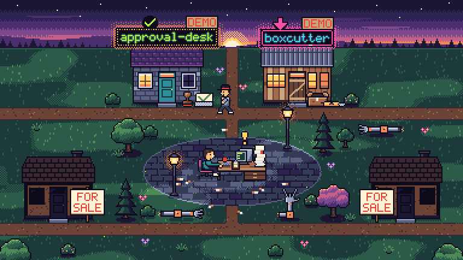
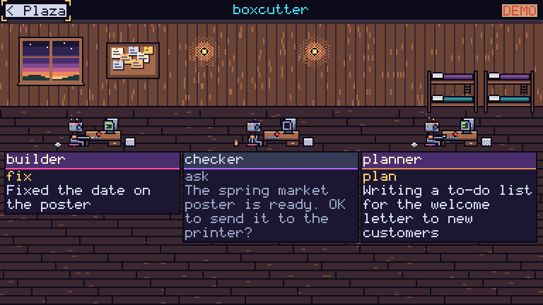
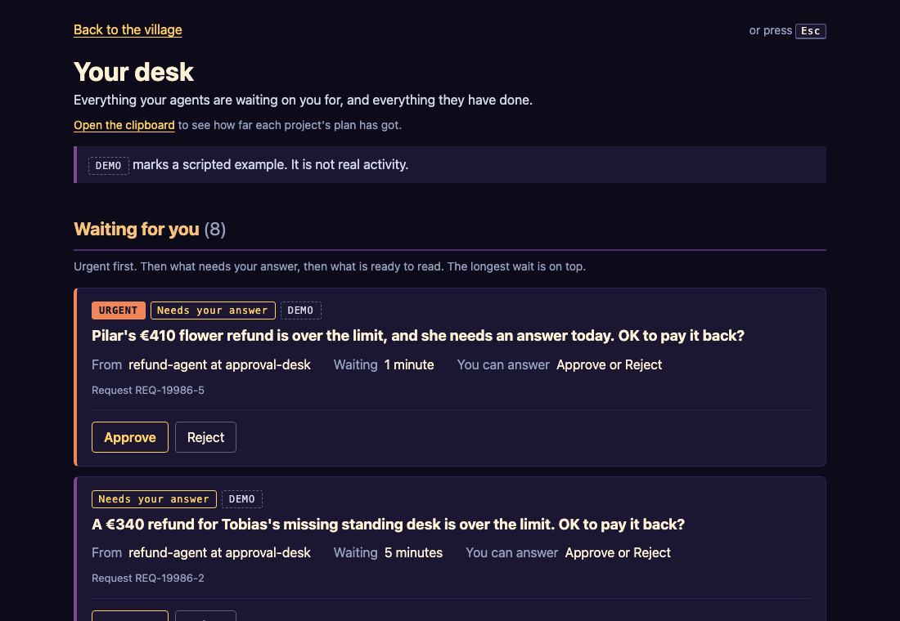
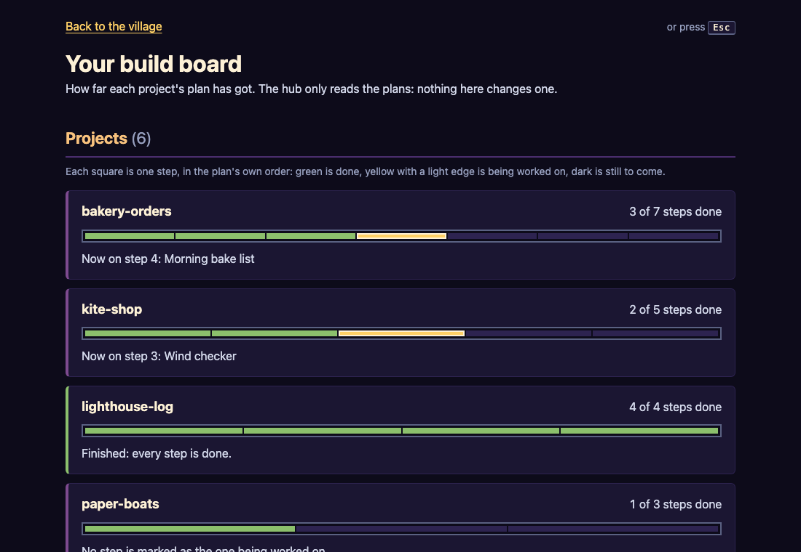

# Agent Hub

A pixel-art village that shows my AI agents and what their workflows are doing.
Each project is a house, each agent lives in one, and I sit at a desk in the
middle where everything that needs me ends up.



Everything you see right now is scripted demo data, marked DEMO on screen.
Nothing calls an AI and nothing goes out to the network.

## Run it

You need Node 24.

```
npm install
npm run hub
```

Then open http://localhost:4040.

## What you are looking at

- **The plaza.** A village square at dusk. The houses light up as their agents work.
- **The houses.** One per project, with its name in neon on the roof. Each lit
  window is an agent at home: bright while it works, soft orange while it waits.
  A house that has gone quiet goes dark with a "no news" note. The two empty
  cottages are for sale, waiting for future projects.
- **The manager.** The man in the hat walks from house to house, knocks, and
  carries anything that needs me back to the desk. Something urgent doesn't wait
  for him: the agent walks it over itself.
- **The desk.** Paperwork piles up next to my computer. Pressing the computer
  opens the desk page: everything waiting for me, urgent first, and a log of
  everything that happened.
- **Inside a house.** Click a house to step in. Each agent has a station with a
  card saying what it is doing right now.
- **The clipboard.** The small clipboard on the desk opens the build board: how
  far each project's plan has got.







## A short demo

1. Open the hub and watch for a minute. The manager does his round and the
   paperwork stack on the desk grows.
2. Press **P** to pause the picture and **P** again to play. The speed button
   next to it runs the village at 2 or 4 times.
3. Click the approval-desk house to look inside, then press **Esc** to go back
   to the plaza.
4. Press **D** to open the desk.
5. Approve a refund of €400 or less. The project's door accepts it, the request
   leaves the desk, and back on the plaza the house goes back to work.
6. Approve a refund over €400. This time the project says no, in plain words.
   The demo projects have their own small rules, and the project's answer wins.
7. Reject something. Reject always asks for a note saying why.
8. Press **Esc** to go back, then **C** to open the clipboard.

Everything also works from the keyboard: Tab moves between the computer, the
houses, the clipboard and the buttons, and Enter or Space presses them.

## What the hub promises

- **It never decides by itself.** A decision exists only when I click it at the desk.
- **It never changes another project.** It only reads their news. A decision
  goes to the project's own door, the project checks it with its own rules, and
  it may say no.
- **Its record is add-only.** What the hub has seen and what I decided is
  written down and never changed or deleted.
- **Demo data always says DEMO.** Scripted activity never looks real.

The full list is in [RULES.md](RULES.md).

## Optional settings

Set these when starting the hub, for example
`HUB_PLANS_FOLDER=/path/to/projects npm run hub`.

| Setting | What it does |
|---------|--------------|
| `HUB_PLANS_FOLDER` | A folder whose subfolders each hold a `PLAN.md`. The build board shows one row per project. Unset, it shows only this hub's own plan. |
| `APPROVAL_DESK_DATABASE` | The path to approval-desk's database. The approval-desk house then shows its real activity instead of the scripted day, and loses its DEMO tag. The hub only reads it. |
| `HUB_DATABASE_PATH` | Where the hub keeps its own record. Defaults to `data/hub.sqlite`, which git ignores. |

## Tests and the safety check

```
npm run typecheck
npm test
npm run e2e
npm run check:public
```

`npm run e2e` starts its own hub, frozen at one moment, so stop any hub you
already have running first.

`npm run check:public` looks through every file git tracks for things that must
never be published: keys and tokens, passwords written into config, tracked
`.env` files, email addresses, phone numbers and home-folder paths. Company,
client and employer names can't be listed in a public file, so it reads them
from `private/banned-names.txt` (one name per line, never committed) and says
whether it found that list. Anything flagged on purpose goes in the `ALLOWED`
list in `scripts/check-public.ts`, with a reason.

The pictures in this README come from the tests' frozen hub. The plaza and the
house are copies of the screenshot tests' own pictures under `e2e/`. To retake
the desk and the build board, run `npm run screenshots`.

## Where things are

- [PLAN.md](PLAN.md): the build steps and where each one stands.
- [ARCHITECTURE.md](ARCHITECTURE.md): the parts, the feed format and the tests.
- [RULES.md](RULES.md): the hard rules and open questions.
- [DECISIONS.md](DECISIONS.md): what was decided at each step, and why.
